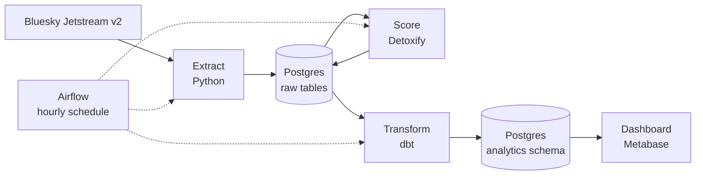

# Bluesky Moderation Pipeline

An end-to-end data pipeline that collects public Bluesky posts in near real time, scores them for toxicity, and models the results for analysis. The goal is to measure how well an off-the-shelf toxicity classifier captures the kinds of harm a trust and safety team actually deals with, and where it falls short.

> **Status:** in progress. Ingestion is working; scoring is being built. See the [roadmap](#roadmap).

## Architecture



1. **Extract** pulls new posts and deletions from Bluesky's Jetstream v2 websocket and stores them raw in Postgres.
2. **Score** runs Detoxify on unscored English posts and saves the scores.
3. **Transform** uses dbt to build clean, tested tables from the raw data.
4. **Orchestrate** uses Airflow to run steps 1 to 3 every hour with retries.
5. **Dashboard** charts toxicity trends and pipeline health in Metabase.

## What works so far

- **Live ingestion** from Jetstream v2 into Postgres, measured at roughly 33 posts per second during testing.
- **Resumable runs.** Each run saves the last event sequence number (`seq`) and resumes from it, so a stopped or crashed run picks up where it left off.
- **Idempotent writes.** Posts are keyed on their `at://` URI and inserted with `ON CONFLICT DO NOTHING`, so replayed or duplicate events never create duplicate rows.
- **Crash safety.** Posts, deletions, and the resume checkpoint are committed in a single transaction, so the checkpoint can never get ahead of the saved data.
- **Deletion tracking.** Deleted posts are recorded in their own table rather than removed, keeping the raw layer intact for reprocessing.
- **Exploratory scoring** of unscored English posts with Detoxify.

## Tech stack

| Layer | Tools |
| --- | --- |
| Ingestion | Python, `websockets`, Bluesky Jetstream v2 |
| Storage | PostgreSQL 16 in Docker, `psycopg2` |
| Scoring | Detoxify (`original` model) |
| Transformation | dbt *(planned)* |
| Orchestration | Airflow *(planned)* |
| Dashboard | Metabase *(planned)* |

## Running it locally

Requires Python 3.11+, Docker Desktop, and Git.

```bash
git clone https://github.com/haleylepe/bluesky-moderation-pipeline.git
cd bluesky-moderation-pipeline

python3 -m venv .venv
source .venv/bin/activate
pip install -r requirements.txt

cp .env.example .env
docker compose up -d
python check_db.py

RUN_SECONDS=60 python ingest/extract_jetstream.py
```

`check_db.py` should print `All checks passed`. After the extract run, check how many posts were collected:

```bash
docker compose exec postgres psql -U haley -d bluesky -c 'SELECT count(*) FROM raw_posts;'
```

## Repository layout

```
├── docker-compose.yml        # Postgres service and volume
├── sql/init.sql              # Table definitions, run on first database start
├── check_db.py               # Health check: connection, tables, read/write
├── ingest/
│   ├── extract_jetstream.py  # Jetstream v2 to raw_posts / deleted_posts
│   ├── score_posts.py        # Detoxify scoring into post_scores
│   └── explore_detoxify.py   # Scratch exploration of scoring
├── requirements.txt
└── .env.example
```

## Early observations

From an initial look at scored posts:

- **Profanity inflates scores.** Casual swearing with no target scores as highly toxic, even when nothing abusive is happening.
- **Context is lost.** Phrases that could be jokes, game talk, or genuine threats receive similar scores, since the model sees only the text of a single post.
- **Some harms are invisible to toxicity scoring.** Spam and solicitation written in neutral, promotional language score near zero. A toxicity model measures hostile language, so these harms need separate, purpose-built detection. Real moderation systems layer several approaches for this reason.

These will be quantified once the pipeline has run long enough to collect a larger sample.

## Limitations

- **Sampled, not complete.** Each scheduled run captures a window of the stream rather than every post on the network.
- **English only.** Detoxify's `original` model is trained on English text, so other languages are excluded from scoring.
- **Toxicity is one signal.** Scores reflect hostile language, not every kind of policy violation.
- **Edits are skipped.** Post updates are not currently ingested.

## Privacy and handling

These are posts from real people, so the project follows a few rules:

- Authors are stored by their permanent account ID (DID), never by handle.
- The dashboard shows aggregates only, not individual posts.
- Deletions are honored downstream; deleted posts are excluded from analysis tables.
- Post text stays in the local database and is never committed to this repository.

## Roadmap

- [x] Postgres in Docker with schema and health check
- [x] Resumable, idempotent extract from Jetstream v2
- [ ] Save Detoxify scores to `post_scores` in batches
- [ ] dbt staging and mart models with tests and source freshness checks
- [ ] Airflow DAG running extract, score, and dbt hourly
- [ ] Metabase dashboard and a written finding
- [ ] Stretch: compare classifier scores with Bluesky's own moderation labels
