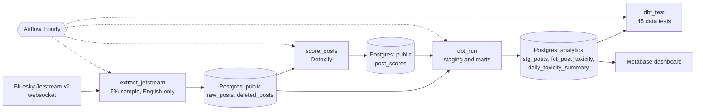

# Bluesky Moderation Pipeline

An end-to-end data pipeline that samples public Bluesky posts from the Jetstream firehose, scores them with the Detoxify toxicity classifier, and models the results in dbt for a Metabase dashboard. Airflow runs the whole thing every hour. The point is to measure how well an off-the-shelf toxicity model covers the harms a trust and safety team actually handles, and to show where it falls short.


<!-- Screenshot placeholder: Airflow > bluesky_pipeline > Graph, after a green run. Save as docs/images/airflow-graph.png -->

## Architecture



Each hour the `bluesky_pipeline` DAG runs four tasks in order:

1. **extract_jetstream** reads the Jetstream websocket for five minutes, resuming from the last saved cursor. It keeps a deterministic 5% sample of post URIs, stores English posts in `raw_posts`, and records deletions in `deleted_posts`.
2. **score_posts** runs Detoxify on up to 6,000 unscored English posts, newest first, and writes six category scores per post to `post_scores`.
3. **dbt_run** builds the staging view and the two mart tables in the `analytics` schema.
4. **dbt_test** runs the data tests. A failure here marks the run failed, so bad data is visible in Airflow instead of silently reaching the dashboard.

## Why I built it

I come from trust and safety work, where the hard problems are operational: too much content for human review, a limited number of reviewers, and decisions that have to be made quickly and consistently. Classifiers are what make that volume manageable. They decide what gets queued, in what order, and what never reaches a person at all.

That makes the classifier's blind spots an operations problem, not just a modeling one. A model that over-flags casual profanity fills the review queue with noise. A model that misses spam or coordinated harassment written in polite language lets real harm through with no signal at all. Thresholds like 0.5 look neutral but quietly set reviewer workload and user experience.

This project builds the measurement side of that problem on live data: a pipeline that continuously scores a real platform's posts, keeps the data clean and tested, and puts the results in front of a dashboard. It treats the classifier the way a moderation team should, as one signal to be audited, and asks how its scores are distributed, which categories actually fire, how stable flag rates are over time, and what the highest-scoring content looks like.

## Tech stack

| Layer | Tools |
| --- | --- |
| Ingestion | Python, `websockets`, Bluesky Jetstream v2 |
| Storage | PostgreSQL 16 in Docker |
| Scoring | Detoxify 0.5 (`original` model), PyTorch |
| Transformation and testing | dbt (`dbt-postgres` 1.11), `dbt_utils` |
| Orchestration | Apache Airflow 3.3 on Astro Runtime, run locally with the Astro CLI |
| Dashboard | Metabase |

## Running it locally

**Prerequisites:** Docker Desktop, the [Astro CLI](https://www.astronomer.io/docs/astro/cli/install-cli), and Git. Python 3.11 or newer is only needed for the optional health check.

1. **Clone the repo.**

   ```bash
   git clone https://github.com/haleylepe/bluesky-moderation-pipeline.git
   cd bluesky-moderation-pipeline
   ```

2. **Create the two env files.** Pick a Postgres password and use the same value in both.

   ```bash
   cp .env.example .env                  # used by docker compose and local scripts
   cp airflow/.env.example airflow/.env  # holds the Airflow connection to Postgres
   ```

   Edit `POSTGRES_PASSWORD` and `DATABASE_URL` in `.env`, and the `password` field in `airflow/.env`. Both files are gitignored.

3. **Start Postgres and Metabase.** On first start, Postgres creates the raw tables from `sql/init.sql`.

   ```bash
   docker compose up -d
   ```

4. **(Optional) Check the database** from your machine:

   ```bash
   python3 -m venv .venv && source .venv/bin/activate
   pip install -r requirements.txt
   python check_db.py   # prints "All checks passed"
   ```

5. **Start Airflow.** The first build takes several minutes because it installs PyTorch, Detoxify, and dbt.

   ```bash
   cd airflow
   astro dev start
   ```

   Airflow's containers reach Postgres through `host.docker.internal:5433`, the port published by docker compose.

6. **Run the pipeline.** Open http://localhost:8080, unpause `bluesky_pipeline`, and click **Trigger**. A run takes about 20 minutes, most of it scoring. From then on it runs every hour while your machine is awake.

7. **Set up Metabase** at http://localhost:3000 by following [metabase/README.md](metabase/README.md). It walks through connecting to Postgres and building the dashboard from the saved queries in [metabase/queries/](metabase/queries/).

To see how runs are going, `python scripts/run_report.py` prints a summary of recent DAG runs and row counts and writes CSVs to `reports/`.

## Data model

The raw layer is written by the Python tasks. dbt builds everything downstream of it in the `analytics` schema.

| Layer | Model | Type | What it holds |
| --- | --- | --- | --- |
| Raw (`public`) | `raw_posts` | table | Every sampled English post as received, including the full event JSON |
| Raw (`public`) | `deleted_posts` | table | Delete events for sampled posts |
| Raw (`public`) | `post_scores` | table | Six Detoxify scores per post, keyed on post URI |
| Staging | `stg_posts` | view | Posts with clean column names and parsed timestamps, minus anything the author deleted |
| Mart | `fct_post_toxicity` | table | One row per scored, non-deleted post with all six scores and an `is_toxic` flag (toxicity of 0.5 or higher) |
| Mart | `daily_toxicity_summary` | table | Per day: posts scored, average toxicity, and the share of posts over 0.5 for toxicity, insult, threat, and identity attack |

Staging is where raw data gets cleaned and deletions are honored. It is a view, so it always reflects the latest raw data. Marts are what the dashboard reads: rebuilt as tables each run, shaped around the questions being asked, and fast to query.

**Tests.** `dbt_test` runs 45 data tests across sources, staging, and marts: post IDs are unique and not null at every layer, timestamps are not null, every Detoxify score and daily share falls between 0 and 1, and every post in the fact table exists in staging. A relationship test that every score belongs to an ingested post is set to warn rather than fail.

## How the pipeline handles real-world data

- **Deterministic sampling.** A post is kept if a hash of its URI falls in the bottom 5%. The same post always gets the same answer, so a later delete event for a sampled post is captured too.
- **Resumable and idempotent.** Each run saves the last Jetstream sequence number and resumes from it. Posts are keyed on their `at://` URI and inserted with `ON CONFLICT DO NOTHING`, so replays never create duplicates. Posts, deletions, and the cursor commit in one transaction, so the cursor can never get ahead of the saved data.
- **Deletions are honored downstream.** Deleted posts stay in the raw layer for reprocessing but are excluded from every analytics model.
- **Scoring is bounded.** Each run scores at most 6,000 posts, newest first, so recent days fill in before the older backlog. Scoring is capped at four CPU threads and runs at low priority so it doesn't starve the local Airflow scheduler.

## Findings

<!-- Fill in from the Metabase dashboard once the pipeline has collected several days of data. -->


<!-- Screenshot placeholder: the Metabase dashboard with all four questions. Save as docs/images/metabase-dashboard.png -->

**Dataset.** _[Date range, number of posts scored, sample rate. Note that early days were captured from the full firehose and later days from a 5% sample.]_

**1. Score distribution.** _[What share of posts score near zero, and how the high end of the distribution looks. Is there a clear split, or a long tail?]_

**2. Flagged volume over time.** _[How stable the share of posts over 0.5 is from day to day, and any days that stand out.]_

**3. Categories.** _[Which Detoxify categories fire most and least, and what that suggests about what the model is really measuring.]_

**4. Top-scoring posts.** _[Patterns in the highest-scoring posts: targeted abuse, casual profanity, quoted slurs, jokes. How many would a human reviewer actually act on?]_

**What this means for moderation operations.** _[Your takeaway: where this classifier would help a review queue, where it would add noise, and what other signals it would need.]_

### Early observations

From an initial look at scored posts:

- **Profanity inflates scores.** Casual swearing with no target scores as highly toxic, even when nothing abusive is happening.
- **Context is lost.** Phrases that could be jokes, game talk, or genuine threats receive similar scores, since the model sees only the text of a single post.
- **Some harms are invisible to toxicity scoring.** Spam and solicitation written in neutral, promotional language score near zero. A toxicity model measures hostile language, so these harms need separate, purpose-built detection.

## Limitations

- **Sampled, not complete.** The extract keeps 5% of posts, and only while the machine running Airflow is awake.
- **English only.** Detoxify's `original` model is trained on English text, so only English posts are stored.
- **Toxicity is one signal.** Scores reflect hostile language, not every kind of policy violation.
- **Edits are skipped.** Post updates are not ingested.
- **Scoring can lag ingestion.** When the backlog grows, the newest posts are scored first and older ones wait.

## Privacy and handling

These are posts from real people, so the project follows a few rules:

- Authors are stored by their permanent account ID (DID), never by handle.
- Dashboard questions show scores and aggregates, not post text.
- Deletions are honored downstream; deleted posts are excluded from analysis tables.
- Post text stays in the local database and is never committed to this repository.

## Repository layout

```
├── docker-compose.yml          # Postgres and Metabase
├── sql/init.sql                # Raw table definitions, run on first database start
├── check_db.py                 # Health check: connection, tables, read/write
├── scripts/run_report.py       # Summary of DAG runs and row counts
├── metabase/
│   ├── README.md               # Connecting Metabase and building the dashboard
│   └── queries/                # SQL for the four dashboard questions
└── airflow/                    # Astro project
    ├── Dockerfile              # Astro Runtime plus a separate dbt virtualenv
    ├── requirements.txt        # Python packages for the Airflow image
    ├── dags/bluesky_pipeline.py
    └── include/
        ├── ingest/
        │   ├── extract_jetstream.py
        │   ├── score_posts.py
        │   └── explore_detoxify.py   # Scratch exploration of Detoxify
        └── dbt/bluesky_dbt/          # dbt project: staging, marts, tests
```

## Next steps

- Compare Detoxify scores with Bluesky's own moderation labels.
- Hand-label a sample of high-scoring posts to estimate precision at the 0.5 threshold.
- Add source freshness checks to the DAG so a stalled extract fails loudly.
